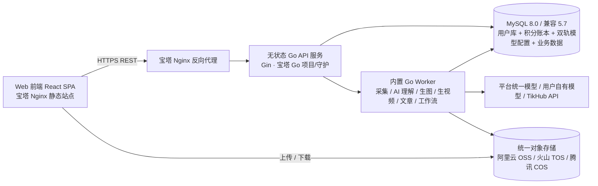

# 03 · 网页化重构与前后端分离改造方案

将 **Viral Studio** 从“单机本地 API + 本地 SQLite + Electron 桌面壳”重构为**非 SaaS 形态（用户自主注册 + 统一后台管理）的前后端分离网页项目**，可保留大部分业务领域与 UI 资产，但必须对**认证鉴权、数据归属、配置加密、文件传输、后台调度与桌面交互**进行系统性改造。

> 实施说明：当前可运行版本采用 **MySQL 任务表 + 内置 Go Worker** 完成异步调度，使用 **JWT + `token_version`** 完成会话失效，不依赖 Redis/Asynq；本文中的 Redis/Asynq 描述属于早期目标架构方案，部署以 [05-Go后端技术选型与宝塔部署方案](05-Go后端技术选型与宝塔部署方案.md) 与当前代码为准。

---

## 一、资产评估：复用 vs 改造 vs 剥离

### 1.1 可高度复用的核心资产
- **后端领域规格与外部协议蓝本（`apps/api/app/domain/`、`apps/api/app/adapters/`、`apps/api/app/services/`）**：
  - 由于新项目后端采用 **Go 语言**实现，原 Python 代码作为精确的**业务规则与外部协议蓝本**进行 Go 化等价迁移：包括热度评分公式、界面展示的 9 种图像工具（POD 6 类 + 修图 3 类）Prompt 与规格校验、产品图 15 秒分镜规则、视频/图文复刻流水线、20 节点工作流 DAG 编译器与状态机、10 类模型供应商协议、微信公众号 API 协议，以及 OSS/TOS/COS 适配接口规范。
- **需重新设计的 C 端平台型前端（不再参考原项目页面布局）**：
  - 原系统的页面形态偏重单机工具与密集表单；网页版重构时**仅保留底层业务能力（13 项创作能力、涂抹重绘交互概念、DAG 工作流编排能力）**，整体前端布局、视觉语言、导航层级与操作流按**面向 C 端的 AI 内容平台**彻底重构（详见 [06-C端平台型原型与界面设计规范](06-C端平台型原型与界面设计规范.md) 及 `prototype/index.html`）。

### 1.2 必须重构的 8 个核心架构断点

| 断点编号 | 原系统单机假设 | 网页化改造硬性要求 | 涉及原代码关键位置 |
| --- | --- | --- | --- |
| **B1 · 认证与会话** | 内存字典 `_sessions` 保存登录态 + 本地文件 `plugin-center-device-id` 绑定单机设备 + 插件中心 5 分钟续期 | 改为**手机号 + 密码注册/登录**（无需审核直接激活，后台可控短信验证码与注册赠分），JWT + `token_version` 会话失效；采集改为后台统一接入 **TikHub** 并对接站内共用积分池 | `app/api/auth.py`、`app/services/market_collection.py` |
| **B2 · 用户数据归属隔离** | 业务主表（`jobs`、`products`、`source_items`、`video_assets`、`clone_drafts`、`collection_*`、`article_publications`）无用户归属字段；仅工作流表有 `principal_ref` | 为全部业务表（含采集 `source_items`、批次、关键词、任务、产品、资产、草稿、工作流）补齐 `owner_user_id`，**所有采集与创作数据仅用户本人可见** | `app/db/models/*`、`app/services/workflows/access.py` |
| **B3 · 数据库与方言绑定** | 默认使用单文件 SQLite，且包含 3 处 SQLite 强耦合：`sqlalchemy.dialects.sqlite.insert`（2 处）、`sqlite3` 直连索引库与在线备份 | 迁至 **MySQL 8.0（严格向下兼容 MySQL 5.7）**；将原按 JSON 内部字段查询的场景（如 `Job.payload["image_tool"]`）抽离为显式列与 B-Tree 索引，避免使用 MySQL 8 专属特性，并消除 `storage-index.sqlite3` | `app/core/config.py`、`app/core/media_storage.py`、`app/services/collection_keywords.py`、`app/services/workflows/runtime.py`、`app/services/desktop_updates.py` |
| **B4 · 双轨模型与密钥保护** | 11 份配置写本机 `.data/*.json`，密钥依赖 Windows DPAPI / macOS Keychain，**Linux 服务器直接报错不可保存** | 拆分为两层：1）**后台统一配置**平台模型、TikHub 密钥与 OSS/TOS/COS 密钥（`system_*` 表）；2）**保留用户自定义模型配置**（`user_provider_configs` 表），均使用服务端主密钥（AES-GCM）加密存储，兼容 Linux 部署 | `app/core/local_secrets.py`、`app/core/*_settings.py` |
| **B5 · 存储三引擎与上传导出** | 原仅支持本地盘、OSS 和 TOS；图片工具通过 `powershell.exe` 弹窗选本机文件夹写盘 | 后台统一配置存储引擎，**补齐腾讯云 COS 适配器**与 OSS/TOS 齐平；**输入**支持直传签名 URL，**输出**取消本地弹窗写盘，改为单图签名下载与批量 ZIP 打包下载 | `app/adapters/object_storage.py`、`app/core/image_tool_output.py`、`app/core/storage_settings.py` |
| **B6 · 进程模型与队列耦合** | `collection` 队列强制寄生在 API 进程内读取内存 Token；`claim_next` 全表串行阻塞（全库共用一条创作队列等） | API 服务完全无状态化；将全部 7 条队列统一交给独立 Worker 执行；队列并发从“全库单通道”改为**“按用户配额 + 全局供应商限流并发控制”**，避免单用户任务阻塞全站 | `app/main.py`、`app/workers/main.py`、`app/db/repositories/jobs.py` |
| **B7 · 通信与实时性** | 前端仅支持本地 Vite 代理且未配置服务端 CORS；任务状态全靠高频轮询 | 后端规范配置 CORS、统一环境变量注入前后端地址；任务进度与工作流事件推荐引入 **SSE（Server-Sent Events）或 WebSocket** 替代密集短轮询 | `app/main.py`、`apps/web/vite.config.ts`、`apps/web/src/App.tsx` |
| **B8 · 本地 CLI 导演桥接** | 复刻导演依赖 `node` 拉起 `codex-director.mjs` 调用本机 `@openai/codex` 可执行文件及本机 `CODEX_HOME` 登录目录 | 在纯网页端不可行且存在服务端环境依赖风险：直接替换为服务端标准 LLM API 结构化 JSON Output 调用（复用后台配置的 `VisionProvider` 模型） | `app/core/codex_account.py`、`apps/desktop/codex-director.mjs` |

### 1.3 建议同步剥离或清理的模块
1. **Electron 桌面壳与在线更新**：完全移除 `apps/desktop/`、`/api/desktop-updates/*`、`install_gate` 写锁中间件、设置页「软件更新」Tab，以及 `/api/internal/workflow-runtime/*` 托盘控制接口。
2. **已退役发布系统包袱**：新项目建库与写接口时，剔除 `RETIRED_PUBLISHING_JOB_TYPES`（5 个）、`RETIRED_NODE_TYPES`（4 个）、`publication_plans` 与 `publication_batches` 表。
3. **已停用的浏览器采集兼容**：剔除返回 `410` 的 `POST /api/platforms/{platform}/session-jobs`、`browser-settings.json` 与 Playwright 浏览器采集依赖；原视频链接兜底统一由 Go 媒体 Worker 按「采集直链 -> `yt-dlp` -> TikHub 单视频直链刷新接口」顺序处理，无需在服务器维护浏览器进程。
4. **彻底移除本机 ComfyUI、Hypit CLI 与视频字幕烧录**：完全剔除 `comfyui`（本机 H3）选项、`@hypit/hypit` CLI 合成以及视频 `.ass` 硬字幕烧录流水线；模型生成全部走第三方云端 API，多段视频拼接与音轨处理统一在 Go Worker 中通过 `ffmpeg` 完成。

---

## 二、目标前后端分离网页架构蓝图

### 推荐核心技术演进清单
- **前端工程独立化**：
  - 技术栈锁定为 **React 19 + TypeScript + Vite**（配合 Node 22+/24 与 `pnpm` 构建），**全面弃用原项目页面与 `themes.css` 旧样式**，采用基于 `ui-ux-pro-max` 生成的 **C 端内容平台设计系统（`design-system/viralstudio-c-platform/MASTER.md`）** 与 `@phosphor-icons/react` 图标库；
  - 引入标准路由（如 `react-router-dom`）与权限路由守卫，划分为**面向 C 端用户的创作平台工作台（灵感广场 / 采集 / 创作工坊 / 复刻 / 资产商品 / 积分绑定）**与**独立的管理员统一后台（`/admin/*`）**；
  - 拆分 `api.ts`（当前单文件已承载全站请求）为按域划分的 Service 模块（`auth`、`collection`、`products`、`creation`、`clone`、`workflows`、`assets`、`settings`、`admin`），并接入 `TanStack Query` 管理缓存与状态更新；
  - 环境变量配置化（`VITE_API_BASE_URL`），支持独立部署至 Nginx / CDN，不再强依赖 Vite Dev Proxy。
- **后端服务分层与资产表显式化**：
  - 建议新增显式 `assets` 元数据表（记录 `owner_id`、对象存储 `object_key`、`mime_type`、`size_bytes`、来源引用），替换原系统“遍历 `.data/media/uploads/` 磁盘目录 + 拼接任务结果”的隐式资产聚合方式；
  - 文件上传/导出全链路走对象存储签名 URL + 临时缓存清理，确保多实例 API/Worker 无共享本地磁盘也可正常工作。
- **安全治理补强**：
  - 保留用户自主配置自定义大模型接口时，必须做好 **SSRF 防护**（禁止用户自定义 `base_url` 指向内网回环 `127.0.0.1`、`localhost`、`169.254.169.254` 或私有网段；原系统 `require_https` 允许本地回环 HTTP，网页版需对普通用户禁用）；
  - 文件上传校验 MIME 与魔数、对媒体处理 Worker 限制并发与单文件体积/时长配额。

---

## 三、分阶段整合落地路线

| 阶段 | 目标 | 核心交付动作 |
| --- | --- | --- |
| **Phase 0 · 工程解耦与底座搭建** | 剥离桌面壳，搭起前后端分离与 Go 底座 | 1. 建立独立 `frontend/`（React）与 `backend/`（Go Gin + GORM）工程，提供宝塔 Nginx 与守护进程配置模板； 2. 接入 MySQL 8.0（兼容 5.7 建表规范）+ Go 存储三引擎适配（OSS/TOS/COS）； 3. 实现用户自主注册/登录与 `admin`/`user` 角色鉴权，业务表补全 `owner_user_id`； 4. 剔除 Electron、`desktop-updates`、退役发布表与 `410` 旧接口。 | 
| **Phase 1 · 统一后台、支付充值与采集主链路** | 管理员配好存储/TikHub/支付与套餐，用户注册并微信/支付宝充值即可采集 | 1. 搭建 `/admin` 后台：注册策略（验证码开关/赠分/重置密码）、用户 CRUD、OSS/TOS/COS 配置、TikHub（含可选代理）与每页扣费规则、积分套餐 CRUD、支付宝/微信支付通道配置与订单管理； 2. 实现共用积分钱包（注册赠分、支付宝/微信扫码支付下单与异步回调入账、后台调账与冻结/结算/退还账本）； 3. 打通个人隔离的 TikHub 分页采集（含批次/条目/关键词 CRUD）、产品多图 CRUD 与 `assets` 资产库 CRUD。 |
| **Phase 2 · 双轨大模型、创作中心与复刻工作台** | 跑通平台扣费模型与用户自有模型双轨创作 | 1. 后台实现平台模型接入与生图/生视频积分定价，前台保留用户自定义大模型与公众号绑定； 2. 实现前端展示的 13 项创作/POD/修图能力与视频/图文复刻流水线（去除未展示的 4 个隐藏修图工具），导出改为单图下载与 ZIP 打包； 3. 用标准 LLM 结构化输出替代 `codex-director.mjs`，视频下载与 FFmpeg 下沉至媒体 Worker。 |
| **Phase 3 · 自动化工作流与全站可观测性** | 跑通定时编排与积分审计监控 | 1. 由内置 Go 工作流调度循环触发计划任务，支持按平台/自有模型自动判定扣费； 2. 在后台上线全站任务监控、积分消费审计报表、异常任务退费核销； 3. 前端采用定时轮询任务状态，并补齐文件/并发/SSRF 安全防护。 | 
