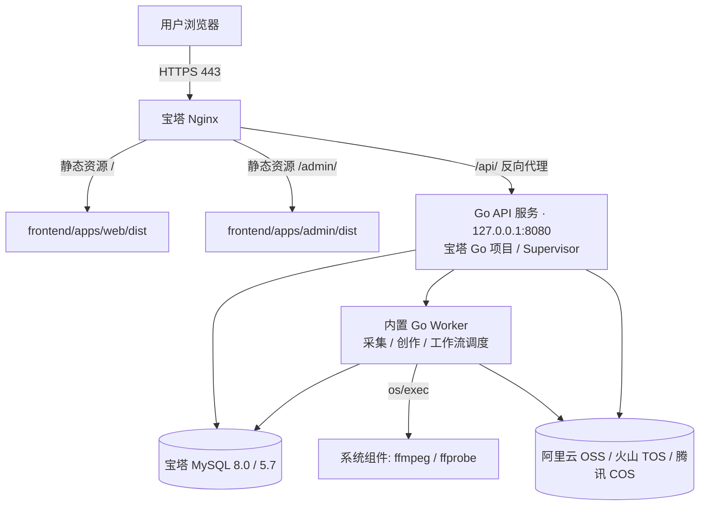

# 05 · Go 后端技术选型与宝塔部署方案

为适配 **Go 语言后端** 与 **宝塔面板（BT Panel）** 生产部署，本文明确 Go 技术栈选型、原 Python 系统能力向 Go 的等价迁移映射，以及宝塔服务器端的完整部署与运维架构。

---

## 一、Go 后端核心技术栈选型

| 能力域 | 推荐 Go 选型 | 选型依据与说明 |
| --- | --- | --- |
| **Web 框架** | `github.com/gin-gonic/gin` | 宝塔 Go 项目生态成熟、中间件丰富，原生支持路由分组（`/api/v1`、`/api/v1/admin`）、CORS 与 `c.Stream` SSE 推送 |
| **数据库与 ORM** | `gorm.io/gorm` + `gorm.io/driver/mysql`（**MySQL 8.0 / 兼容 5.7**） | 宝塔软件商店一键托管，Go 驱动原生兼容 MySQL 8.0 `caching_sha2_password` 与 5.7 `mysql_native_password`；配合 `utf8mb4_unicode_ci` + 显式索引列 + 避免 CTE/窗口函数/`SKIP LOCKED`，实现 5.7/8.0 无缝运行 |
| **数据库迁移** | GORM `AutoMigrate` | 当前版本由应用启动时自动建表；正式环境建议再补充版本化 SQL 迁移与备份 |
| **任务队列与调度** | MySQL 任务表 + 内置 Go Worker | 采集与创作任务持久化到数据库，由 Worker 每 2 秒原子认领；创作任务双并发，视频任务轮询上游状态，失败自动退回预冻结积分。无需额外部署 Redis，降低宝塔环境复杂度 |
| **鉴权与加密** | `golang-jwt/jwt/v5` + `golang.org/x/crypto/bcrypt` + 标准库 `crypto/aes`（AES-256-GCM） | 替代原插件中心内存会话及 Windows DPAPI / macOS Keychain，实现跨平台 API Key 加密存储 |
| **对象存储三引擎** | `aliyun-oss-go-sdk`（OSS）、`ve-tos-golang-sdk`（TOS）、`cos-go-sdk-v5`（COS） | 统一封装为 `adapter/storage.ObjectStorage` 接口，支持服务端上传/下载与预签名 URL |
| **HTTP 客户端** | 标准库 `net/http` 或 `go-resty/resty` | 对接 TikHub API、10 类大模型供应商与微信公众号官方 API，配合上下文超时与统一重试中间件 |
| **支付网关对接** | `wechatpay-go` + 支付宝开放平台签名/验签 SDK（如 `smartwalle/alipay/v3`） | 支撑微信 Native/JSAPI 与支付宝当面付/网页扫码直充下单、异步回调验签及幂等入账 |
| **SSRF 防护拨号器** | 自定义 `net.Dialer.Control` | 用户自定义大模型 `base_url` 与远端图片/视频下载器强制校验解析后 IP 禁止回环/内网/元数据网段，防 DNS 重绑定 |
| **图像处理** | 标准库 `image` + `github.com/disintegration/imaging` | 支撑图片尺寸探测、蒙版校验（`InpaintCanvas` 局部重绘/消除传图）与缩略图生成 |
| **文档解析与排版** | `pdfcpu` / 系统 `pdftotext` + Go `html/template` | 替代原 `pypdf` 文档解析与 `wechat-article-layout/render.py` 公众号 HTML 内联排版渲染 |
| **音视频处理与下载** | `os/exec` 安全封装 `ffmpeg` / `ffprobe` / `yt-dlp` | 通过 `context.WithTimeout` + 参数白名单调用服务器命令行工具完成探测、抽帧、音轨处理与公开视频下载 |
| **批量导出打包** | 标准库 `archive/zip` | 流式打包生成图片/素材 ZIP 供前端浏览器直接下载（替代原 `powershell.exe` 本地弹窗写盘） |

---

## 二、原系统（Python）向 Go 等价迁移映射

| 原 Python 模块 | Go 新工程落点 | 迁移策略说明 |
| --- | --- | --- |
| `app/api/auth.py` + 插件中心登录 | `internal/httpapi` + `internal/auth` | 彻底废弃插件中心内存 Session 与设备 ID，改为手机号注册/登录（可控短信验证码与注册赠分）、JWT + `token_version` 会话失效与 `admin`/`user` RBAC 拦截 |
| `app/core/local_secrets.py` + 11 个 JSON 配置 | `internal/pkg/crypto` + `provider_configs` / `user_provider_configs` / `system_settings` | 弃用本地 JSON 与 OS 钥匙串；统一使用 `APP_MASTER_KEY` 进行 AES-256-GCM 加密后存入数据库 |
| `app/services/market_collection.py` | `internal/adapter/tikhub` + `internal/service/credits` | 移除插件中心钱包代理，直连 TikHub REST API，并将计费闭环内建为站内 `credit_wallets` + `credit_transactions` |
| `app/adapters/models/*`（第三方供应商） | `internal/ai` + `internal/httpapi/studio_worker.go` | 移除本地 ComfyUI 与 `@hypit/hypit`；按统一 Go 接口实现第三方云端厂商协议与异步轮询（Seedance、MiniMax、可灵、通义万相、OpenAI、Google、Midjourney、DeepSeek 与 OpenAI 兼容自定义供应商），结果立即转存对象存储 |
| `app/workers/video_captions.py` + `hypit_composition.py` | **移除字幕烧录 / 仅保留 `ffmpeg` 合成** | 按需求移除视频硬字幕烧录与 `@hypit/hypit`；多段拼接与原声/模型音轨混音由 `ffmpeg` 直接执行 |
| `app/domain/workflow_graph.py` + `orchestrator.py` | `internal/httpapi/workflow_runner.go` | 保留可视化工作流启停、计划触发与运行记录；生成节点复用 Studio Worker 的任务、积分与退费链路 |
| `app/core/codex_account.py` + `codex-director.mjs` | `internal/service/clone`（标准 LLM JSON Schema 调用） | 直接删除 Node/Codex CLI 子进程依赖，改用后台或用户配置的视觉/对话模型输出结构化分镜脚本 |
| `app/adapters/object_storage.py` | `internal/adapter/storage` | 在 OSS 与 TOS 逻辑基础上补齐腾讯云 COS 驱动，废弃 `storage-index.sqlite3` 本地同步索引 |
| `app/adapters/platforms/wechat.py` + `wechat_publish.py` | `internal/httpapi` 个人中心公众号绑定 | 保留 AppID/AppSecret 加密保存、出口 IP 展示与启停管理；公众号文章生成结果进入个人资产库，发布能力可按后续需求扩展 |
| `app/core/image_tool_output.py` | `internal/api/assets`（ZIP 打包 / 签名下载） | 删除 `FolderBrowserDialog` 弹窗逻辑，提供单图预签名下载链接及多选勾选流式打包 ZIP 接口 |
| `apps/desktop/*` + `desktop_updates.py` | **完全移除** | 新工程不包含任何桌面壳、系统托盘与在线安装包更新代码 |

---

## 三、宝塔面板（BT Panel）生产部署架构



### 3.1 服务器基础软件准备（宝塔面板）
1. **软件商店安装**：
   - **Nginx**（推荐 1.24+）
   - **MySQL 8.0**（或 **MySQL 5.7**，SQL 迁移脚本与表结构已按 5.7 严格兼容标准编写）
   - **Supervisor 管理器**（或使用宝塔自带「网站 → Go 项目」管理进程，守护单个 `studio-server` 常驻进程；API 与 Worker 在同一进程内运行）
2. **系统级媒体命令行依赖**（SSH 装在服务器 `/usr/local/bin`）：
   - `ffmpeg` & `ffprobe`（静态编译包或系统源安装，用于视频探测、关键帧抽取、音视频后处理）
   - `poppler-utils`（用于文章参考 PDF 文档文本提取 `pdftotext`）

### 3.2 编译与上线流程
1. **前端构建**：C 端与后台分别构建后，将产物按目录上传至宝塔站点根目录（如 `/www/wwwroot/studio-web`）：
   ```powershell
   cd frontend/apps/web
   npm ci
   npm run build

   cd ../admin
   npm ci
   npm run build
   ```
   - 将 `frontend/apps/web/dist/*` 放到站点根目录 `/www/wwwroot/studio-web/`；
   - 将 `frontend/apps/admin/dist/*` 放到 `/www/wwwroot/studio-web/admin/`，不要与 C 端产物平铺混放。
2. **后端交叉编译为 Linux 单二进制**（在开发机或构建机执行）：
   ```powershell
   $env:CGO_ENABLED="0"; $env:GOOS="linux"; $env:GOARCH="amd64"
   go build -ldflags="-s -w" -o dist/studio-server ./cmd/server
   ```
   将二进制文件与 `.env` 上传至 `/www/wwwroot/studio-backend/`。
3. **进程守护（二选一）**：
   - **API 服务**：在宝塔「网站 → Go 项目」或 Supervisor 中启动 `./studio-server`，监听 `127.0.0.1:8080`；
   - **异步任务**：同一进程启动后会同时拉起采集 Worker、创作 Worker 与工作流调度循环，无需额外端口或队列服务；
   - **首次初始化管理员**：通过环境变量 `ADMIN_INIT_PHONE` / `ADMIN_INIT_PASSWORD` 启动自动初始化，或执行 `./studio-server init-admin` 创建首个 `admin` 账号；
   - **存储与微信平台配合项**：在 OSS/TOS/COS 控制台为前端域名放行浏览器直传 CORS（`PUT`/`GET`/`HEAD`）；在微信公众平台将当前服务器公网出口 IP 加入白名单（系统 `/profile` 绑定弹窗会直接展示出口 IP，遇到 `40164`/`89506` 错误时给出明确引导）。

### 3.3 宝塔 Nginx 核心配置要点
在宝塔站点设置 → **配置文件** 中，需重点配置两项规则：
1. **C 端与后台 SPA History 路由兜底**：
   ```nginx
   # C 端前台
   location / {
       try_files $uri $uri/ /index.html;
   }

   # 统一管理后台，必须是 /admin/ 前缀
   location ^~ /admin/ {
       try_files $uri $uri/ /admin/index.html;
   }
   ```
2. **常规 API 反代与大文件上传**：
   ```nginx
   client_max_body_size 500m;
   location /api/ {
       proxy_pass http://127.0.0.1:8080;
       proxy_set_header Host $host;
       proxy_set_header X-Real-IP $remote_addr;
       proxy_set_header X-Forwarded-For $proxy_add_x_forwarded_for;
       proxy_set_header X-Forwarded-Proto $scheme;
       proxy_read_timeout 300s;
   }
   ```
3. 任务进度由前端定时轮询 `/api/v1/studio/jobs` 获取，无需额外的 SSE/WebSocket 反代配置。

### 3.4 宝塔安全与运维建议
- **端口收敛**：宝塔安全/防火墙仅对外开放 `80`、`443`（以及限定 IP 的 SSH/宝塔面板端口），`8080`（Go API）与 `3306`（MySQL）全部只监听 `127.0.0.1`。
- **HTTPS 强制开启**：通过宝塔「SSL → Let's Encrypt」一键签发证书并开启强制 HTTPS（保证 Cookie/JWT 安全传输以及前端混合内容兼容）。
- **宝塔计划任务（备份与清理）**：利用宝塔自带「计划任务」每日自动备份 MySQL 数据库（尤其是积分钱包与交易流水表），并定期清理后端临时转码缓存目录 `/tmp/studio-media/`。
